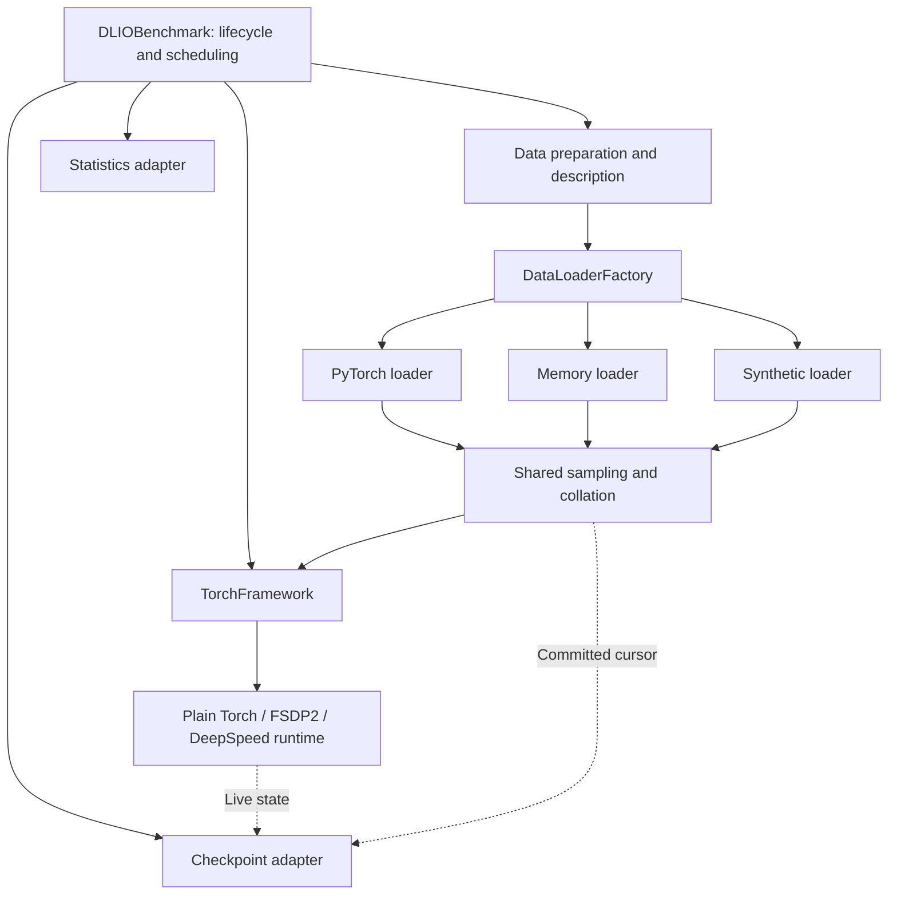

**Reviewed draft: share DLIO's benchmark lifecycle and data loaders with Llama**

Execution tracking: the shared Llama TODO (kept outside this repository).
See the source-verification appendix for the 2026-10-22 review and concrete
implementation clarifications.

> **Status, 2026-11-02: partly implemented.** Built: one shared sampler with
> disk, RAM and generated-token delivery for the native runner (steps 3 and 4),
> explicit `workload.reader` settings, bounded worker lifetime, per-worker
> tracing, online tokenization (not part of this design) and
> `llama.host_sync=step`. Only partly built: the shared contracts (step 1, no
> dataset-description or window-result types), preparation extraction (step 2)
> and metrics (step 7, a minimal `summary["delivery"]` record). Not built: the
> `TorchFramework` runtime selection (step 5), the shared lifecycle and v2
> checkpoints (step 6) and the removal of `LlamaBenchmark` and `LlamaFramework`
> (step 8); the native runner is kept. `docs/source/llama.rst` describes current
> behavior. The text below is the original proposal and still describes the
> work that was not built.

The proposed result is one `DLIOBenchmark` lifecycle for Llama, ResNet, UNet,
and synthetic workloads. Llama will use `TorchFramework`, `ModelFactory`, and
`DataLoaderFactory`, with backend-specific training runtimes and token-specific
data preparation. Remove `LlamaBenchmark` and its delegation branches after
equivalent behavior is covered through the shared entry point.

This is a design proposal, not an implementation. The feasibility conclusions
below come from the current working tree and small CPU probes. No production
training code was changed while preparing this plan.

Source review found the architecture feasible, with corrections needed for
legacy step scheduling, fileless dataset identity, worker lifetime and memory,
configuration defaults, framework instance lifetime, and epoch-boundary restart.
Those decisions are incorporated below. Implementation acceptance remains
conditional on the tests specified here; feasibility probes do not establish
full training or GPU compatibility.

**The existing loaders can be reused after extending their data contracts.**

| Loader | Current behavior and obstacle | Proposed reuse | Feasibility |
| --- | --- | --- | --- |
| `pytorch` | `TorchDataLoader` constructs `TorchDataset` and the existing rank sampler. Its reader path usually returns `resized_image`; it has no committed resume cursor. | Allow an injected indexed dataset, batch sampler, and collator. Supply the existing `TokenDataset` and a shared resumable sampler. Retain the existing reader-backed dataset path. | High; standard PyTorch collation already preserves the token dictionaries and integer types. |
| `load_mem` | Wraps `TorchDataLoader`, caches its finished local batches, and replays them. Dictionary contents survive, but the first epoch's order and rank assignment become fixed. | Add an indexed record cache beneath batching. Apply the same epoch sampler and collator to cached records. Keep the existing batch-cache behavior for legacy callers during migration. | High for bounded datasets; needs a different cache granularity and an explicit host-memory budget. |
| `synthetic` | Preallocates one zero-filled `uint8` tensor using image dimensions and repeats it. It cannot currently produce token dictionaries. | Accept a sample provider. A generated-token provider produces vocabulary-valid IDs, masks, labels, and sample IDs without files. Keep the existing zero-image provider as the legacy default. | High for generated token workloads; it does not represent OpenHermes input. |
| TensorFlow / DALI / native DALI | Their current pipelines do not consume the native token record contract. | Preserve their existing workloads through compatibility adapters. Reject their selection for Llama in this change. | Outside this refactor's acceptance scope. |

Relevant source:

- [Current benchmark delegation](../dlio_benchmark/main.py).
- [PyTorch loader and sampler](../dlio_benchmark/data_loader/torch_data_loader.py).
- [Memory loader](../dlio_benchmark/data_loader/load_mem_data_loader.py).
- [Synthetic loader](../dlio_benchmark/data_loader/synthetic_data_loader.py).
- [Reader base and placeholder image return](../dlio_benchmark/reader/reader_handler.py).
- [Token records and current sampler](../dlio_benchmark/llama/data.py).

Four isolated CPU probes were run in an isolated temporary
environment, Torch 2.9.1+cpu, ten generated records, sequence length eight, and
batch size two. The temporary records were removed after the probes.

| Probe | Observed result | Limit of the evidence |
| --- | --- | --- |
| Feed `TokenDataset` to PyTorch `DataLoader` using the current loader's batch indices. | IDs, masks, labels, and sample IDs match the current token loader; tensors have shape `[2, 8]` and dtype `torch.int64`. Four token files were handled. | Single process, no workers or GPU pinning. |
| Bridge token batches into the existing `LoadMemDataLoader`. | Dictionary batches are preserved exactly. After changing the underlying sampler to epoch two, the cache still returns epoch one's order. | The bridge was a temporary probe, not a production loader integration. |
| Construct the existing `SyntheticDataLoader`. | It returns a `uint8` tensor of shape `[2, 4, 4]`, with no labels or mask. | Confirms the existing default contract only. |
| Generate IDs in memory using `SeedSequence([seed, sample_id])`. | All ten records match file generation exactly, including full-loss labels. | Establishes content equivalence for the current generated-token algorithm only. |

A subsequent verification used 35 records, two simulated rank assignments,
batch size two, accumulation two, and standard PyTorch loading with zero or two
spawned CPU workers. The two-worker probe required local IPC outside the sandbox;
the initial sandbox run was stopped after its socket operation was denied.

| Verification | Result |
| --- | --- |
| Rank assignment and tail | Rank sample sets were disjoint, 32 records were used, and three were dropped. This checked sampler assignment, not distributed model execution. |
| Iterator RNG | Creating an iterator changed global Torch RNG without a dedicated generator, including with zero workers. Supplying a dedicated generator preserved global RNG. |
| Prefetch versus consumption | After two consumed microbatches, the two-worker loader had dispatched six. The zero-worker loader had dispatched two. |
| Cursor restoration | Reconstructing an iterator from committed cursor two reproduced all remaining batches exactly with both worker counts. This checked loader restoration, not a complete model checkpoint restart. |
| Worker byte accounting | The parent counter recorded 1,088 application bytes with zero workers and zero with two workers, confirming that the existing counter cannot measure worker reads. |

No GPU, new memory-cache implementation, or revised training/checkpoint runtime
was exercised by these probes. Those checks remain implementation acceptance work.

**Data source and delivery mode should be independent settings.**

Retain `llama.data_source` for content and use the existing
`reader.data_loader` setting for delivery. The native path currently constructs
`TokenLoader` directly, so changing `reader.data_loader` alone has no effect.
For older native YAMLs that omit loader settings, resolve the loader to
`pytorch`, worker count to zero, `iter_time` to zero, and `pin_memory` to false.
The last two choices preserve today's native path, which neither sleeps between
batches nor pins them. Do not inherit `ConfigArguments`' current TensorFlow-loader,
one-worker, one-second-delay, and pinning defaults. Resolve explicit settings
from the composed workload configuration before populating compatibility
defaults, validate them, and record the effective configuration.

| Data source | `pytorch` | `load_mem` | `synthetic` |
| --- | --- | --- | --- |
| `dlio_tokens` | Read generated token files. | Prepare/read generated token files once, then serve cached records. | Generate equivalent records in memory; no token files required. |
| `openhermes` | Read prepared conversation token files. | Prepare/read the same token files once, then serve cached records. | Reject with an actionable configuration error. |

With `synthetic`, preserve deterministic sample identity rather than repeatedly
returning a single batch. Generated content should match the file-backed source
for the same seed, vocabulary, sequence length, pad ID, and logical sample ID.
Generation must use a local RNG and must not advance the model's RNG state.
OpenHermes tokenization, packing, truncation, EOS handling, and loss masking
remain preparation concerns shared by the two loaders that consume that data.

Use `dataset.format=token_records` for the token sample schema across all three
delivery modes. Switching to the synthetic loader must not require replacing
that format with the legacy image-oriented `synthetic` format. The loader mode
determines whether token files are needed. Continue accepting the legacy
`synthetic` format for existing image workloads.

For a synthetic generation-only run, explicitly requesting `generate_data=true`
writes the reusable cache. The same explicit request during training prepares
the cache outside timed training, even though synthetic delivery does not read
it. A training run with
`reader.data_loader=synthetic` and `generate_data=false` must work without it.
Record preparation work separately from the loader's zero file-read traffic.

**The shared design should assign each responsibility to one component.**

The diagram describes the PyTorch path. TensorFlow and other existing framework
choices remain selected through the framework factory and participate in the
same outer lifecycle through adapters.

Llama-specific configuration, conversation formatting, pretrained loading, and
backend implementations can remain separate modules. They must not own their
own epoch loop, checkpoint schedule, statistics lifecycle, or finalizer.
Moving the current runner into another class with a different name would not
meet the objective.

**Implement the migration in the following order.**

1. **Capture compatibility requirements and introduce narrow shared contracts.**

   Preserve current native Llama input bytes, sample order, loss normalization,
   optimizer checkpoint boundaries, evaluation computation, and weight/data/RNG
   restart requirements. The v2 schema explicitly improves pending epoch-end
   work and final-save deduplication as described in step six. Existing synthetic
   checkpoint workloads keep their tensor allocation, timing, and checkpoint-only modes.

   Capture tiny-model v1 checkpoint fixtures with the current implementation
   before removing it. Verify migration against those independently produced
   files rather than a fixture written by the new schema code itself.

   Add a dataset description with actual global record counts, split identity,
   format, sequence length where applicable, and a dataset/provider constructor.
   File count and maximum records per file are metadata, not the authoritative
   sample count. The last token file may contain fewer records.

   Supply a logical content identity separately from an optional token-file
   manifest fingerprint. Fileless generated data identity includes generator
   version, PRNG algorithm/NumPy version, effective split seed, record count,
   vocabulary size, sequence length, pad ID, and loss policy. Preserve the current
   training seed and evaluation seed offset of `+1` for both generation and
   sampling. OpenHermes identity retains resolved dataset/tokenizer revisions,
   formatting and packing options. Checkpointing and metrics must consume this
   description rather than assume every dataset has `.manifest` or `.bytes_read`.

   Define loader operations for `read`, `next`, `set_epoch`, `commit`,
   `state_dict`, `load_state_dict`, `finish_epoch`, and `close`. `finish_epoch`
   releases the active iterator while retaining reusable RAM records; `close`
   releases the loader completely at run completion or failure. Adapt legacy
   per-epoch `finalize` calls without changing their existing meaning. New methods should have
   compatibility defaults or adapters so existing custom loaders are not forced
   to implement restart immediately. A loader that cannot resume must advertise
   that limitation and be rejected when resumable native training is requested.

   Define a runtime result containing loss where available, local sample count,
   global valid-target count where applicable, consumed microbatches, optimizer
   boundaries, and applied updates. Keep scope explicit for reduced metrics so
   already-global token counts are not multiplied by world size again.

   Keep cumulative runtime progress separate from samples and tokens processed
   during this invocation. This distinction matters after a restart.

   Keep the common checkpoint sampler state identical across ranks: epoch,
   committed microbatch cursor, base seed, global dataset identity, batch size,
   accumulation, and world size. Per-rank worker seeds, counters, and resource
   state belong outside the all-rank equality check. Never serialize a live
   iterator, prefetched queue, process group, or cached dataset into a checkpoint.

2. **Extract preparation and make configuration derivation dataset-aware.**

   Move model/tokenizer metadata resolution, asset identity, token-cache locking,
   and split preparation out of `LlamaBenchmark` into preparation helpers that
   return the dataset description. Helpers must not construct the training
   runtime or start a training loop.

   Extend configuration derivation to accept prepared dataset descriptions.
   Split general validation from file/image-specific derivation and validation.
   Do not create `resized_image`, infer token dimensions through a square root,
   invent image filenames, or run the existing file-alignment trimming for token
   datasets. Keep the current derivation path for legacy datasets.

   Use the `token_records` format value in all native example YAMLs. Resolve formats for
   older native YAMLs that omitted the setting; reject an explicitly conflicting
   image format. The token dataset is injected directly into the PyTorch loader;
   it does not call the image-oriented `FormatReader.read_index` implementation.

   The injected dataset path also needs its own small, serializable worker
   specification. Do not run `TorchDataset.worker_init` for it: that method
   unpickles `ConfigArguments`, which resets MPI/config/logger singletons even
   in the parent process when workers are disabled. Workers receive paths,
   scalar metadata, and explicit tracing context, never the live framework or
   MPI communicator. Existing custom loader constructors retain their old
   positional signature; only opt-in adapters receive the new dataset contract.
   Reject unsupported custom token readers/loaders instead of ignoring them.

   Keep optional imports lazy, including preparation factories. A base import
   and synthetic image run must not require Transformers, Datasets, or DeepSpeed.
   Generation-only execution resolves model/tokenizer metadata but never
   allocates pretrained model weights.

3. **Extract the current token ordering into a shared committed sampler.**

   Preserve the existing native token algorithm: an epoch permutation based on
   `SeedSequence([seed, epoch])`, sliced into microbatch/rank/sample dimensions.
   Use one owner of sharding; neither DeepSpeed nor a second distributed sampler
   may repartition the same samples.

   Keep the legacy file-map and sample-shuffle policy behind its existing adapter.
   Applying the token permutation to image/custom datasets by default would
   change their current ordering. Shared interfaces do not require identical
   sampling policy for every workload.

   For `N` records, microbatch size `B`, world size `W`, and accumulation `A`, use
   `floor(N / (B * W * A)) * B * W * A` training records. Every rank must execute
   the same number of complete accumulation windows. Evaluation uses `A=1`.
   Report discarded records and reject datasets too small for one window.

   Separate the iterator's dispatched position from its committed position.
   Prefetching can advance dispatch; only successful runtime completion advances
   the checkpoint cursor. Preserve the current behavior of consuming a completed
   DeepSpeed window even when its optimizer update is skipped, and report that
   skip through `applied_updates`.

   On restart, reconstruct the permutation and start dispatch at the committed
   cursor. Do not restore by fetching and discarding earlier data. Save the
   sampler algorithm version as well as seed, epoch, cursor, dataset identity,
   batch size, accumulation, and world size.

   Extend `TorchDataLoader` and its factory with optional dataset, batch-sampler,
   and collator inputs. For tokens, preserve `input_ids`, `attention_mask`, and
   `labels` as integer tensors. Standardize sample metadata without forwarding
   it to the model. Group microbatches into complete windows in one shared helper.
   Retire `TokenLoader` after its ordering and cursor behavior are reproduced.

   Initially prove the shared path with `read_threads=0`. Then qualify workers
   and prefetch before enabling those settings for native Llama. Iterator and
   worker seeds must use a dedicated generator, so iterator creation after RNG
   restoration cannot consume the model's global Torch RNG. Token reads remain
   deterministic and free of worker-dependent random transformations.

   For token disk/synthetic delivery with workers, use `spawn` and initially
   disable persistent workers. Reject an explicitly selected `fork` context for
   this path: the iterator can be created after CUDA/NCCL initialization. Keep
   injected providers and worker callbacks importable and picklable. Report local
   fetch/worker failures to the other ranks before entering the next runtime
   collective, with bounded worker timeouts.

4. **Extend the memory and synthetic loaders using the same sampler.**

   For `load_mem`, cache indexed records before batching. Reuse the epoch sampler
   and collator rather than preserving shuffled, prebatched output. Rebuild the
   cache on restart before restoring training RNG; the cache itself is not a
   checkpoint payload.

   The first token implementation should preload the complete indexed dataset
   on each rank. The current global permutation can move any record to any rank
   in later epochs, so caching only the first epoch's local records is incorrect.
   Keep compact int32 token records in contiguous buffers where practical and
   derive masks/cast to int64 at batch collation. Budget both training and
   evaluation caches, the sampler permutation, temporary batches, and pinned buffers per process and
   across all ranks sharing a node. Add `reader.memory_budget_bytes` as a
   positive per-rank limit for the new token memory-cache path, and compare
   aggregate rank requirements with available node memory. Fail before partial
   allocation if the budget cannot fit; propagate the failure across ranks
   during initialization. Do not silently switch to a disk-backed mode.
   Node-shared caches are a later optimization.

   Require `read_threads=0` for the initial token memory-loader implementation.
   Passing a NumPy RAM cache to spawned workers can duplicate it per worker;
   allocating once in the parent does not establish a shared-memory cache.
   Disk and synthetic loaders receive worker qualification in this change;
   memory-loader workers require an explicit shared-storage design later.

   Preserve the existing legacy memory-loader behavior until its users migrate
   to the indexed contract. Add recursive handling of dictionaries, tuples, and
   lists when pinning batches; the current manual pinning does not descend into
   token dictionaries. Pin bounded collated batches rather than the full corpus.
   Keep `reader.iter_time` as an explicit per-microbatch delay and report it.

   For `synthetic`, add a generated-token sample provider with a declared record
   count. Use the same sampler and collator as the other two loaders. Return
   full-length IDs, all-one attention masks, unshifted labels, and sample IDs.
   Validate vocabulary bounds and at least two positions; do not synthesize
   token inputs by casting the current zero-image batch. Preserve the existing
   precreated image batch behavior for legacy image workloads.

   Keep rank-local RAM caches independent in this first version. Full replication
   per rank is the chosen simple strategy for preserving the current global
   sample order without cross-rank cache transfers. A stable rank partition or
   node-shared cache could reduce replication, but would require different
   ordering or a separately tested storage design.

5. **Make `TorchFramework` select a training runtime and defer allocation.**

   Replace its eager constructor allocation with an explicit initialize hook.
   Keep device/process-group ownership in one place and initialize only the
   selected runtime. Fold the responsibilities of `LlamaFramework` into this
   shared selection path, then remove the separate framework class.

   Give each benchmark invocation a fresh framework/runtime. The existing
   `TorchFramework.get_instance` singleton can otherwise return a previous run's
   model or destroyed process group, especially in the in-process restart test.
   Stop using that singleton in the benchmark factory; preserve a legacy helper
   only if its cleanup/reset behavior is explicit. Update direct framework tests
   to call initialization and test two sequential runs with different runtimes.
   Construct loaders only for enabled splits; the existing base `init_loader`
   unconditionally constructs both training and evaluation readers.

   Adapt existing ResNet/UNet batch preparation and update methods into the
   plain Torch runtime with accumulation one. Preserve their existing optimizer
   choices. Keep FSDP's meta construction, shard loading, mixed precision, and
   optimizer-after-sharding order. Keep DeepSpeed's configuration-before-loading
   order and engine ownership of backward, accumulation, clipping, and updates.
   No extra DDP wrapping is applied to these backends.

   The runtime contract should expose initialization, `train_window`, explicit
   evaluation, synchronization, progress, checkpoint state, and teardown. Preserve
   global valid-token normalization across the whole accumulation window.
   Tracing must not automatically compile the sharded backends. Model/task
   selection remains a factory concern rather than a lifecycle branch in main.

6. **Use one benchmark loop, checkpoint scheduling path, and cleanup path.**

   `DLIOBenchmark.initialize` performs shared logging/tracing, preparation,
   dataset-dependent validation, loader construction/preloading, runtime
   initialization, checkpoint adapter construction, and optional restoration.
   Training timing starts after preparation and memory preload.

   Move resource acquisition into the explicit initialization scope, including
   device selection. Validate storage and checkpoint capabilities before large
   allocations; the first native implementation still requires shared POSIX
   checkpoint storage. General factory reuse does not enable unsupported storage.

   The shared training sequence is fetch a complete window, run the runtime,
   commit consumed data, record metrics, and schedule checkpoints. The current
   Llama policy uses global optimizer boundaries across epochs and restarts.
   The current shared image/synthetic loop resets its step limit and periodic
   checkpoint counter each epoch. Preserve that behavior through a legacy
   scheduling policy during extraction, even though its printed description
   suggests a global limit. Record the effective policy and keep separate
   cumulative optimizer and epoch-batch counters. Unifying the legacy limit
   semantics would be a separate behavior change, not an incidental refactor.

   Check stop limits before fetching the next window and bound each iterator's
   batch sampler to the remaining scheduled work. This avoids dispatching a full
   epoch when a global step limit ends the run early. Preserve live resume when
   periodic checkpoint saving is disabled.

   Shared evaluation calls an explicit evaluation method, enters eval mode,
   disables gradients, restores the previous mode and training RNG, and never
   updates parameters or optimizer state. This also fixes the existing generic
   `_eval` call through the PyTorch training `compute` method; add an image-model
   regression test for that behavior change. Provide the equivalent TensorFlow
   evaluation hook using `training=False` without applying gradients so the
   common API does not route TensorFlow evaluation through its training method.

   Retain allreduce-simulation barriers only for workloads requesting simulated
   compute/communication. Native runtimes perform their actual collectives.
   Preserve deliberate collective checkpoint completion and synchronized device
   timing. Do not place unconditional MPI barriers in failure cleanup.

   Generalize the checkpoint factory to receive runtime and run/loader state.
   Adapt existing synthetic and custom mechanisms to the common interface without
   allocating synthetic `BaseCheckpointing` state for live training. Keep FSDP
   DCP and DeepSpeed engine storage implementations, per-rank RNG, completion
   manifests, fsync policy, immutable save directories, and final-save deduplication.

   Preserve each legacy workload's configured checkpoint state source, including
   existing synthetic checkpoint behavior attached to image training. Select the
   live adapter through an explicit resolved policy, not merely because a runtime
   contains a model. This refactor does not automatically convert legacy image
   checkpoints to a different payload format.

   Extend custom checkpoint discovery as well as dispatch: it currently requires
   subclasses of the synthetic `BaseCheckpointing`. Legacy subclasses remain
   supported through adapters; opt-in live mechanisms implement the new state
   interface without inheriting its tensor allocator.

   Preserve v1 file-backed Llama checkpoint reads: validate the original exact
   identity first, then translate its loader cursor into the new sampler state.
   Write a versioned new schema including sampler/provider versions and delivery
   mode. Initially require the same loader mode when resuming new checkpoints;
   content equivalence alone is not a promise of cross-mode restart compatibility.
   Same backend/stage, world size, recorded versions, and training identities
   remain required.

   Specify epoch-end progress in the new schema. Currently a periodic save can
   happen after the last training window but before evaluation; resume sees a
   full cursor and advances to the next epoch, losing that pending evaluation.
   Persist the phase (`training`, `post_train_pending`, or `epoch_complete`) and
   last completed evaluation/epoch-checkpoint events. Resume pending end-of-epoch
   work before advancing, even if the training step limit is already reached.
   Evaluation must be deterministic and replayable; use event IDs to deduplicate
   reports because a crash after evaluation but before another save can replay it.
   Final-save deduplication compares complete resume state, including this phase,
   rather than only optimizer step. A final save at the same step is justified
   when it records newly completed epoch-end work. For v1, preserve the historical
   completed-cursor behavior and document that pending epoch-end events cannot
   be recovered from metadata it never stored.

   Add idempotent common finalization and a local failure cleanup path that works
   after partial initialization. Both stop active profiling and release only
   owned resources. Normal finalization retains existing dataset retention rules;
   token caches remain retained. Failure cleanup preserves the original exception.

   Close training/evaluation iterators and workers before releasing caches,
   stopping worker tracing, or destroying the distributed runtime. Cleanup must
   handle early limits, exceptions, generation-only runs, and failed constructor
   setup. Do not drain the entire remaining epoch merely to stop workers.

7. **Share statistics events and make loader traffic explicit.**

   Keep one benchmark event surface with adapters for existing `StatsCounter`
   output and native token metrics. Preserve output filenames and existing schema
   markers; add fields rather than passing tokens through image record-size or
   utilization calculations. Existing native `LlamaStats` may initially become
   an adapter; it must no longer own a benchmark lifecycle.

   Record preparation time, checksum-validation bytes, preload time/bytes,
   cache resident bytes, samples served, valid targets, timed application reads,
   intentionally delayed time, checkpoint stored bytes, and save/load duration
   separately. The memory loader has preload reads and zero steady-state token
   file reads. The synthetic provider has zero token file reads; CPU generation
   time remains part of fetching. Neither claim excludes model or checkpoint I/O.

   Worker reads cannot use the current parent-only `TokenDataset.bytes_read`
   counter unchanged. Publish per-worker read counters into parent-visible shared
   state at read completion, including read-ahead that is never consumed. Do not
   rely on a final worker callback: PyTorch may terminate workers during shutdown.
   Snapshot counters after workers stop; mark them incomplete on fatal worker
   failure rather than presenting partial counts as exact. Keep normal early-stop
   shutdown bounded and test the chosen cleanup adapter against the pinned Torch
   version; it has no public DataLoader `close` method. Label consumed record
   bytes separately from observed application reads. Do not claim physical
   storage traffic or cache misses from either measurement.

8. **Complete acceptance tests, then remove the bypass.**

   Extend the existing tiny-model and fresh-process tests to drive the shared
   entry point and loader factory. Replace tests that reach through
   `benchmark._native_llama` with shared runtime, loader, and metrics access.
   Keep real backend tests; mocks alone do not establish FSDP/DeepSpeed restart.

   Remove `dlio_benchmark/llama/benchmark.py`, `_native_llama`, and lifecycle/failure
   delegation branches in `main.py`. Remove `framework/llama_framework.py` after
   its context/runtime setup is covered through `TorchFramework`. A transient
   migration adapter can exist in intermediate changes but not in the final
   implementation. Update usage docs and all three native workload YAMLs with
   explicit supported loader settings.

**Acceptance should cover both preserved behavior and the new delivery modes.**

| Area | Required evidence |
| --- | --- |
| Shared architecture | ResNet, UNet, and Llama run through the same outer lifecycle; no Llama runner or early delegation remains. Factories select tasks, loaders, and runtimes. |
| Content and masks | Disk and RAM paths return identical generated and OpenHermes records, including full/response-only labels, EOS-as-PAD, packing, and short final files. Generated in-memory records match file generation for every logical ID. |
| Ordering | Two ranks receive disjoint samples and equal complete-window counts; all three modes use identical generated-data order for at least two epochs. Nondivisible dataset sizes produce the declared tail count. |
| Memory delivery | Preload is measured separately; indexed cache order changes correctly with epochs; no token file access occurs during steady-state batches; dictionaries and labels survive collation/pinning. Budget both train/eval caches across local ranks. Reject memory-loader workers in the initial implementation. Memory-budget failures propagate before distributed training begins. |
| Synthetic delivery | Training and evaluation work with no token cache and `generate_data=false`; IDs use the full model vocabulary, vary by sample, and remain reproducible across fresh processes. OpenHermes plus synthetic is rejected. |
| Prefetch and restart | Disk/synthetic loaders with zero and two spawned workers resume from consumed rather than dispatched samples; RAM delivery uses zero workers. Verify next sample IDs, loss, parameters, optimizer state, and RNG against uninterrupted continuation, including dropout and an epoch boundary. Early limits and worker failures leave no orphan workers. |
| Backend behavior | FSDP2, ZeRO 2, and ZeRO 3 retain pretrained weight loading, FP32/BF16 behavior, activation checkpointing, accumulation, skipped-update accounting, and synchronous save/load. Qualify tiny models on CPU and actual backends on multiple target GPUs. |
| Checkpoint compatibility | Old v1 file-backed Llama checkpoints load through the declared conversion; new checkpoints restore each supported mode in a fresh process. Incomplete, incompatible, wrong-mode, and wrong-world-size checkpoints fail before weight mutation. |
| Lifecycle | Generation-only allocates no training model; evaluation changes no parameters/optimizer/progress; Llama global limits survive restarts while legacy per-epoch limits retain their policy. Kill/resume between the final training window and evaluation; v2 performs pending epoch-end work. Final saves are skipped only when complete resume state matches. Sequential benchmark instances cannot reuse a stale runtime. Partial initialization and local failures release resources without extra cleanup collectives. |
| Configuration | Changing only the token loader mode does not conflict with `token_records` format. Native omitted defaults add no artificial delay. Generated evaluation uses the historical seed offset. Unsupported custom adapters, forked token workers, and unsupported storage fail before model allocation. |
| Metrics | Byte counts distinguish validation, preload, dispatched reads, consumed records, and checkpoint payloads. Global token counts are reduced once. Memory and synthetic modes are not reported as timed storage reads. |
| Existing workloads | PyTorch image training with disk, memory, and synthetic delivery, TensorFlow where installed, existing DALI/custom loader interfaces, synthetic Llama checkpoint-only workloads, and optional-import isolation retain their supported behavior. |

The loader matrix does not require a full Cartesian product of every GPU test.
Prove content/order equivalence at the loader level, restart per mode with a tiny
model, and backend correctness with the existing fresh-process backend matrix.
Add focused multi-rank integration cases joining each newly supported mode to a
sharded runtime. GPU pinning, GPU kernels, and memory capacity require GPU checks;
the CPU feasibility probes above do not establish those properties.

**The main files affected are identifiable before implementation starts.**

| Files or modules | Planned change |
| --- | --- |
| `main.py` | Shared initialization, window loop, evaluation, checkpoint schedule, and cleanup; remove Llama delegation. |
| `framework/framework.py`, `torch_framework.py`, `framework_factory.py` | Add initialization/evaluation/runtime hooks and compatibility defaults; select one PyTorch framework with fresh per-run runtime ownership. |
| `framework/tf_framework.py` | Add the evaluation compatibility hook needed by the common lifecycle without routing evaluation through a training update. |
| `framework/llama_framework.py` | Fold initialization and context ownership into the shared framework, then delete. |
| `llama/config.py`, new preparation helpers, `model/pytorch/llama.py` | Retain validated options, lazy metadata/tokenizer preparation, asset identity, and pretrained model construction. |
| `llama/data.py`, new shared sampling/description helpers | Retain record format and conversation preprocessing; extract ordering and migrate away from `TokenLoader`. |
| `llama/runtime.py` | Retain tested backend algorithms behind the shared runtime contract. Relocation is optional and should not obscure behavior changes. |
| `data_loader/base_data_loader.py`, `data_loader_factory.py` | Add dataset injection, capabilities, and resumable-state support with legacy compatibility. |
| `torch_data_loader.py`, `load_mem_data_loader.py`, `synthetic_data_loader.py` | Support indexed token records, RAM caching before batching, and deterministic generated sample providers. |
| `common/enumerations.py`, `utils/config.py` | Recognize token format, derive actual sample counts, and validate the source/loader matrix. |
| `checkpointing_factory.py`, live checkpoint adapter, legacy adapters | Dispatch live or synthetic state explicitly; version loader metadata and support v1 migration. |
| `utils/statscounter.py`, `utils/llama_stats.py` or replacement adapters | Consume shared events while preserving compatible outputs and accurate byte scopes. |
| Native YAMLs, `docs/source/llama.rst`, loader configuration docs, tests | Document delivery modes and update lifecycle/restart/regression coverage. |

Deliver contracts and preparation first, then disk-backed shared loading and
the memory/synthetic extensions against the same sampling contract. Follow with
framework/runtime selection, the shared lifecycle and checkpoints, and metrics.
Qualify workers and restart behavior before final removal. Each intermediate
change should remain runnable; the final acceptance gate requires all eight
steps and removal of both Llama-specific orchestration classes.

## Source verification and implementation clarifications — 2026-10-22

Reviewed against the current `feat/llama` worktree at
`1035482c4ba390e0b485008e706863a79cbbd0a7`, including its existing uncommitted
files. This review confirms source structure and refines the proposed contracts;
it does not rerun the earlier CPU probes or establish GPU support.
The execution breakdown is in the shared Llama TODO (kept outside this repository).
L00–L11 expand the eight migration steps above; Q01–Q04 track cluster/feature
qualification and F01 tracks deferred aggregation. Their acceptance evidence is
required before any implementation item is marked complete.

### Findings checked against source

| Finding | Evidence | Consequence |
| --- | --- | --- |
| Separate lifecycle and framework remain | [main.py](../dlio_benchmark/main.py), `DLIOBenchmark.__init__/initialize/run/finalize`; [framework_factory.py](../dlio_benchmark/framework/framework_factory.py) | L06/L07 must move ownership; L11 removes delegation. |
| Native training constructs TokenLoader directly | [llama/benchmark.py](../dlio_benchmark/llama/benchmark.py), `initialize`; [data.py](../dlio_benchmark/llama/data.py), `TokenLoader` | Merely changing reader.data_loader has no effect today. L02/L03 integrate the factory. |
| Memory caching occurs after batching; synthetic input is uint8 image data | [load_mem_data_loader.py](../dlio_benchmark/data_loader/load_mem_data_loader.py), `read/next`; [synthetic_data_loader.py](../dlio_benchmark/data_loader/synthetic_data_loader.py), constructor | L04 needs an indexed record cache; L05 needs a token provider. |
| Worker initialization restores global configuration; persistent workers are enabled | [torch_data_loader.py](../dlio_benchmark/data_loader/torch_data_loader.py), `TorchDataset.worker_init/TorchDataLoader.read` | Injected token datasets require a separate worker path and explicit lifetime management. |
| Framework allocation is eager and factory uses a singleton | [torch_framework.py](../dlio_benchmark/framework/torch_framework.py), constructor; framework factory | L06 defers allocation and creates fresh per-run ownership. |
| Generic evaluation calls the training compute interface | [main.py](../dlio_benchmark/main.py), `_eval`; Torch/TensorFlow training methods | L07 requires explicit evaluation hooks and image-model regression checks. |
| Native resume advances past a full cursor; final-save deduplication uses only the step | [llama/benchmark.py](../dlio_benchmark/llama/benchmark.py), `run`; [llama_checkpointing.py](../dlio_benchmark/checkpointing/llama_checkpointing.py), v1 schema | L08 must represent pending epoch-end work and complete resume state. |
| Record masks use stored length and reader bytes are parent-local | [data.py](../dlio_benchmark/llama/data.py), `TokenDataset.__getitem__` | L04 preserves lengths; L09/L10 handle worker counters and verification traffic. |
| FSDP2/DeepSpeed runtime algorithms already exist | [runtime.py](../dlio_benchmark/llama/runtime.py), `train_window` and backend initialization | Extract interfaces while preserving algorithms; GPU qualification remains Q01/Q02. |

### Concrete contracts and corrections

1. **Injected PyTorch loading (L03).** Extend the factory with keyword-only,
   opt-in dataset/batch-sampler/collator arguments while retaining old positional
   constructors. With a batch sampler, do not also pass batch_size, sampler,
   shuffle or drop_last. Use one native permutation owner; a second sampler
   must not shard already partitioned records. Keep iterator RNG separate even
   with zero workers.

2. **RAM representation (L04).** Preserve the original length alongside int32
   IDs and labels. Attention masks are position < length, not ID != pad ID:
   a valid EOS token may have the same ID as PAD. The minimum record payload is
   `N * (2*L + 1) * 4` bytes for each cached split, before sampler permutations,
   metadata, temporary int64 batches and pinned buffers. Budget all local ranks
   against the usable allocation/node memory and fail collectively before
   allocation. This formula is a payload lower bound, not a peak-memory estimate.

3. **Workers and validation (L09).** Manifest construction currently hashes
   token files. Do not silently multiply this work by rebuilding full datasets
   independently in every spawned worker. Validate during preparation and pass
   immutable metadata to worker-local readers; separately account for any
   deliberate revalidation. Workers receive no live framework/MPI singleton.
   Cooperative fetch failures are exchanged before runtime collectives; dead
   ranks require bounded process-group/launcher handling, not an unconditional
   cleanup barrier. Any use of private iterator-shutdown APIs must be isolated
   behind a tested adapter for the pinned Torch version.

4. **Checkpoint identity and naming (L08).** Define v2 common state as schema,
   backend/stage/world size, exact package/model/data identities, delivery mode,
   sampler/provider versions, committed cursor, runtime progress, epoch phase
   and completed event IDs. Per-rank RNG remains separate. Validate old v1
   identity before conversion and preserve its documented inability to recover
   epoch-end state that was never recorded. Keep immutable directories: add a
   monotonic save sequence or complete-state digest to new save identifiers,
   because different epoch phases may require distinct saves at the same step
   and label. Deduplicate only identical complete resume states.

5. **Failure and metric boundaries (L07/L10).** Commit consumed samples only
   after successful window completion; preserve the existing treatment of
   DeepSpeed skipped updates. Record partial failures without presenting an
   incomplete window as checkpointable progress. Emit globally reduced token
   counts once. Count completed worker reads, including read-ahead, separately
   from consumed records and from checksum/preload traffic. Zero steady-state
   token reads in RAM/synthetic modes does not mean zero model/checkpoint I/O.

6. **Qualification order.** Capture v1 fixtures before replacing the old writer.
   Run Q01 on the existing implementation as soon as source/assets/stack gates
   pass; it need not wait for the shared-loop refactor. Q02 repeats evidence on
   the migrated code. DALI/FFCV remain required follow-on work, though the first
   migration rejects those Llama selections. FULL/SELECTIVE aggregation is
   deferred and must not replace raw per-call evidence for latency studies.
   Keep OpenHermes fixture support during regression testing; its selection for
   the production experiment remains a project decision.

### Delivery and review gates

Deliver L01/L02 contracts and preparation, then L03 disk loading. L04 RAM and
L05 synthetic share that sampler; L06 runtime extraction can progress after
preparation. L07 joins them in the lifecycle, L08 versions checkpoint state,
L09 qualifies workers, and L10 verifies accounting. L11 integrates regressions,
packaging, YAML/docs and removes the old runner/framework only after acceptance.
No task is complete from source inspection alone.

Each task in the shared TODO states dependencies, target files, implementation
subtasks and required evidence. Record skips explicitly. Tiny CPU fixtures prove
content and restart semantics only within their tested scope; GPU pinning,
backend kernels, full-model capacity and distributed behavior need Q01/Q02 and
the E08 timing/launch gates before E09 scaling.
